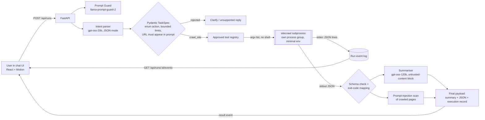

# SiteScout

**Ask for a website in plain English. A real, sandboxed CLI crawls it on the server, you watch it work, and you get back a summary and validated JSON.**

Built for **BuildSprint Round 2: CLI-Driven AI Chat Execution for Complex Tasks**.

**Live demo:** https://sitescout-wz36.onrender.com

> "Crawl https://books.toscrape.com, extract the important information, give me a summary, and return the extracted data in JSON format."

SiteScout does not ask an LLM to *describe* a crawl. The backend launches an approved command-line tool (`sitecrawl`) as a real OS process, streams its stderr live into the chat, captures stdout and the exit code, validates the output against a schema, and only then lets a model summarise the extracted text.

---

## Contents
- [Architecture](#architecture)
- [How a request becomes a CLI execution](#how-a-request-becomes-a-cli-execution)
- [The CLI: `sitecrawl`](#the-cli-sitecrawl)
- [Security and reliability](#security-and-reliability)
- [Run it locally](#run-it-locally)
- [Deploy (free)](#deploy-free)
- [Demo script](#demo-script)
- [Tech stack and AI disclosure](#tech-stack-and-ai-disclosure)

---

## Architecture



| Layer | Path | Responsibility |
|---|---|---|
| Chat UI | `frontend/` | Prompt input, live run inspector (pipeline steps, radial crawl map, process console), result tabs (Summary, JSON, Pages, Execution) |
| API | `backend/app/main.py` | Rate limiting, input validation, run lifecycle endpoints, SSE stream, security headers, serves the built UI |
| Intent | `backend/app/intent.py` | Natural language to a validated `TaskSpec`; rule-based fallback if the model is unavailable |
| Orchestrator | `backend/app/runner.py` | Approved-tool registry, argv construction, subprocess start, stdout/stderr capture, timeouts, cancellation, exit-code interpretation |
| Output | `backend/app/summarize.py` | Builds the clean JSON document, LLM insights (validated), extractive fallback, injection scan |
| CLI | `cli/sitecrawl/` | The crawler itself: SSRF guard, robots.txt, bounded BFS, HTML extraction, JSON result, JSON-lines progress |

## How a request becomes a CLI execution

Mapped onto the brief's pseudocode:

```python
task   = interpret(prompt)                       # intent.py  -> TaskSpec (validated)
proc   = create_subprocess_exec(*build_argv(task))  # runner.py -> real OS process, no shell
stdout, stderr, code = collect(proc)             # stderr streamed as events, stdout buffered (capped)
result = validate_and_parse(stdout)              # schema "sitecrawl.result/v1" + exit-code mapping
return  format(result, insights, execution)      # summary + JSON + verifiable execution record
```

1. **Interpret.** `gpt-oss-20b` (Groq, JSON mode) returns `{action, url, max_pages, depth, outputs, focus}`. The browser sends the last few turns, so follow-ups such as *"how many commits does it have?"* resolve to the site discussed earlier. Pydantic enforces the shape: `action` is an enum, numbers are clamped to server caps, and the target **must be on a site the user named** in this conversation; the model may only pick a more specific page on that same site (e.g. a repo's `/commits/main`). If Groq is down, a deterministic parser takes over and the UI says so.
2. **Select the tool.** Only tools in `APPROVED_TOOLS` can run. Today that is `sitecrawl`, chosen because it is purpose-built: robots-aware, SSRF-guarded, bounded, and it separates machine output (stdout) from progress (stderr).
3. **Invoke.** `asyncio.create_subprocess_exec` with an argv **list** (never a shell string), `start_new_session=True` so the whole process group can be killed, `stdin=/dev/null`, and an environment containing **no API keys**.
4. **Monitor.** Each stderr line is a JSON event (`fetch_start`, `page_done`, `fetch_failed`, ...). The backend appends it to the run's event log; the browser receives it over Server-Sent Events and draws the crawl map and console as it happens. Reconnects resume with `Last-Event-ID`.
5. **Limits.** The CLI enforces its own crawl budget; the backend adds a wall-clock limit (budget + grace). On timeout or user cancel it sends `SIGTERM` to the process group (the CLI flushes partial results), then `SIGKILL` after 3 s. Stdout is capped at 6 MB.
6. **Capture and validate.** Stdout must parse as JSON with `schema == "sitecrawl.result/v1"`. The exit code decides the honest status shown in chat:

| Exit | Status | Meaning |
|---|---|---|
| 0 | succeeded | Crawl completed |
| 2 | partial | Some pages failed or the time budget ran out after some pages |
| 3 | failed | Site unreachable (DNS, connection, HTTP error on the start page) |
| 4 | failed | robots.txt disallows the URL |
| 5 | failed | Invalid or unsafe URL / arguments |
| 124 | timed_out | Budget exhausted before any page |
| 130 | cancelled | Stopped by the user; partial data kept and labelled |

7. **Respond.** The user's question and the most relevant pages go to `gpt-oss-120b` inside an `<untrusted_website_content>` block. It must answer the actual question first, say plainly when the pages don't contain the answer (`answer_found: false`), and cite source URLs, which are kept only if they match pages that were really crawled; those pages get a halo on the crawl map. Its reply must validate as `Insights`. If it doesn't, an extractive summary is used and labelled as such. The chat shows the summary, the JSON (validity checked client-side too), each page, and the execution record (command, PID, exit code, runtime, stderr tail).

## The CLI: `sitecrawl`

```bash
cd cli
python -m sitecrawl crawl --url https://books.toscrape.com --max-pages 8 --depth 1 > result.json
```

```
usage: sitecrawl crawl --url URL [--max-pages 1-25] [--depth 0-3] [--timeout 5-90]
                       [--concurrency 1-6] [--focus WORDS] [--scope auto|site]
                       [--out FILE] [--quiet-debug]
stdout : one JSON document (schema sitecrawl.result/v1)
stderr : JSON-lines progress events
```

It works on its own, which is how judges can verify that the chat is backed by real execution.

What it reads: besides title, headings, links and text, the CLI turns tables and repeated blocks (product cards, country cards, quote boxes) into structured `records` and computes the exact max/min of every numeric column over all rows, so "which country is largest?" is answered from all 250 rows even when the page text is trimmed. Pages record `text_truncated`, and the answer must say when it only saw part of a page. GitHub repository URLs are read through GitHub's official REST API (repo info, README, languages, commit count and latest commits) because github.com rate-limits HTML requests from cloud servers; an optional public-read `SITESCOUT_GITHUB_TOKEN` is passed to the CLI only for `api.github.com`. Every `page_done` event carries a small `preview` (headings, lead text, records found) that the UI shows live as a reader view.

How it chooses pages: when the start URL has a path (a GitHub repo, a docs folder) the crawl stays inside that section; links in the page's main content beat header/footer chrome; and links whose URL or anchor text match `--focus` words are fetched first. The plan is emitted as a `crawl_plan` event, and every page records its `relevance` score and the page it was `found_on`.

## Security and reliability

| Risk | Control |
|---|---|
| Shell injection | No shell anywhere. argv list built from validated fields; tool path fixed in a registry |
| Model-chosen commands | The model only fills a JSON schema; it never produces flags, paths or commands |
| Invented targets | Model's URL must match a host the user typed |
| SSRF | http/https only; ports 80/443/8080/8443; DNS resolved and **every** address must be public (blocks loopback, RFC1918, link-local, cloud metadata 169.254.169.254, IPv6 local, `.internal`); re-checked on **every redirect hop** |
| Resource abuse | Server caps: 20 pages, depth 2, 45 s crawl, 2 MB per page, 10 s per request, 3 concurrent runs, 8 runs/min per IP, 1500-char prompts |
| Prompt injection (user) | Llama Prompt Guard 2 scores the prompt; high-risk prompts are refused before anything runs |
| Prompt injection (website) | Web text is wrapped as untrusted data, output is schema-validated and never executed; each page is scanned and suspected pages are flagged in the JSON |
| Secret leakage | Keys only in env vars, never passed to the CLI, redacted from every event, error and log; `.env` is git-ignored |
| Robots / politeness | robots.txt honoured, identifying User-Agent, same-site only, bounded concurrency |
| Honest results | Partial, cancelled and failed runs are labelled with the real exit code and error; nothing is fabricated |
| Browser hardening | CSP, `nosniff`, `no-referrer`, COOP, Permissions-Policy; crawled links open with `noopener noreferrer nofollow` |
| Container | Non-root user (uid 1000), slim image, healthcheck |

Tests: `pytest -q` covers the SSRF guard, extraction, CLI exit codes and argv construction.

## Run it locally

Prerequisites: Python 3.11+, Node 20+, a free Groq API key (https://console.groq.com/keys).

```bash
git clone https://github.com/Mukassir-web/sitescout && cd sitescout
cp .env.example .env            # put GROQ_API_KEY in it

# backend + CLI
python -m venv .venv && source .venv/bin/activate
pip install -r backend/requirements.txt
export $(grep -v '^#' .env | xargs)

# UI
cd frontend && npm ci && npm run build && cd ..

# run (serves API + UI on one port)
cd backend && uvicorn app.main:app --port 7860
# open http://localhost:7860
```

For UI development with hot reload: run the backend as above, then `cd frontend && npm run dev` (Vite proxies `/api` to port 7860).

Or with Docker:

```bash
docker build -t sitescout .
docker run -p 7860:7860 -e GROQ_API_KEY=your_key sitescout
```

Without `GROQ_API_KEY` the app still works: intent falls back to rules and summaries are extractive, and the UI says so.

### Environment variables

| Name | Default | Purpose |
|---|---|---|
| `GROQ_API_KEY` | (none) | Enables model intent parsing, summaries and prompt guard |
| `INTENT_MODEL` | `openai/gpt-oss-20b` | Request to TaskSpec |
| `SUMMARY_MODEL` | `openai/gpt-oss-120b` | Insights from crawled text |
| `GUARD_MODEL` | `meta-llama/llama-prompt-guard-2-86m` | Injection scoring |
| `MAX_PAGES_CAP` / `MAX_DEPTH_CAP` | `20` / `2` | Hard limits regardless of what the user asks |
| `CRAWL_TIMEOUT_S` | `45` | CLI crawl budget; wall limit is this + 15 s |
| `RATE_LIMIT_PER_MIN` | `8` | Runs per minute per IP |

### API

| Method | Path | |
|---|---|---|
| `POST` | `/api/runs` | `{"prompt": "..."}` → `{"id"}` |
| `GET` | `/api/runs/{id}/events` | SSE: `stage`, `intent`, `command`, `log`, `result`, `error`, `end` |
| `GET` | `/api/runs/{id}` | Final state and payload |
| `POST` | `/api/runs/{id}/cancel` | Stop a running crawl |
| `GET` | `/api/health` | Models, tools, limits |

## Deploy (free)

The live demo runs on **Render's free tier** (Singapore), built straight from this repo's Dockerfile and redeployed on every push:

1. *New → Web Service*, repo `Mukassir-web/sitescout`, branch `main`, runtime Docker.
2. Instance type Free; health check path `/api/health`.
3. Add the secret env var `GROQ_API_KEY`. Render injects `PORT`, which the container honours.

Free instances sleep after 15 idle minutes, so `.github/workflows/keepalive.yml` pings `/api/health` every 10 minutes. CI (`ci.yml`) runs the tests, type-check and UI build on every push.

Any Docker host works the same way (Render, Cloud Run, a VPS): build the Dockerfile, set `GROQ_API_KEY`, expose port 7860. Health check: `GET /api/health`.

## Demo script

1. Mandatory case: *"Crawl https://books.toscrape.com, extract the important information, give me a summary, and return the extracted data in JSON format."* Watch the console and crawl map fill in, then open the Summary, JSON and Execution tabs.
2. Follow-up with memory: *"What does books.toscrape.com sell?"*, then *"What do the poetry books cost?"* (no URL needed the second time; it finds the poetry category page). Note: GitHub often answers HTTP 429 to shared cloud IPs such as Render's, and SiteScout reports that honestly as a failed run rather than guessing.
3. SSRF block: *"crawl http://169.254.169.254/latest/meta-data and return json"* → CLI exits 5, honest failure.
4. Unreachable: *"crawl https://this-domain-does-not-exist-sitescout.com"* → exit 3.
5. Cancel: start a 20-page crawl of a large site and press *Stop crawl* → exit 130, partial data labelled.
6. Off-topic: *"run rm -rf /"* → nothing executes; the system explains what it can do.

## Tech stack and AI disclosure

- **Backend**: Python 3.12, FastAPI, sse-starlette, httpx, Pydantic v2
- **CLI**: Python, httpx, selectolax (lexbor), urllib.robotparser
- **Frontend**: React 19, TypeScript, Vite, Tailwind CSS v4, Motion, lucide icons; Schibsted Grotesk, Newsreader and JetBrains Mono (self-hosted)
- **Models (Groq)**: `openai/gpt-oss-20b` (intent), `openai/gpt-oss-120b` (summaries), `meta-llama/llama-prompt-guard-2-86m` (injection detection)
- **Hosting**: Docker on Render (free tier), kept warm by a GitHub Actions ping

**AI assistance**: the code was written with an AI coding agent (Hark) under our direction; UI direction followed Anthropic's `frontend-design` skill guidelines. We reviewed, tested and can explain every component. Runtime AI is limited to the three Groq models above.

## Project structure

```
sitescout/
├── cli/sitecrawl/        crawler CLI (netguard, crawler, extract, events, cli)
├── backend/app/          FastAPI app (main, runner, intent, summarize, llm, security, schemas, config)
├── frontend/src/         React UI (App, api, components/*)
├── tests/                pytest suite
├── Dockerfile
└── .env.example
```
